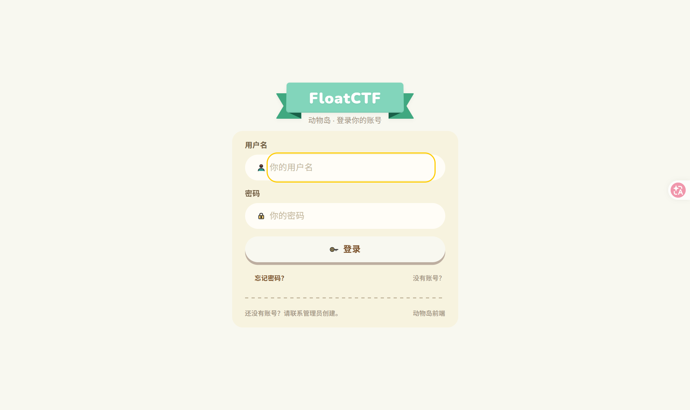
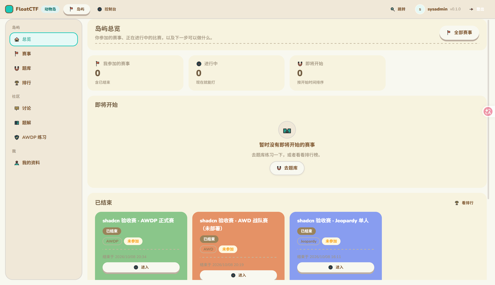
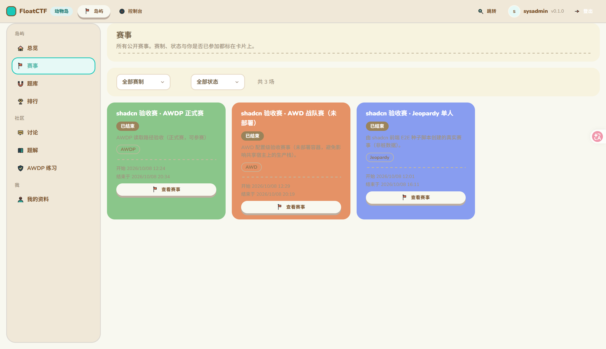
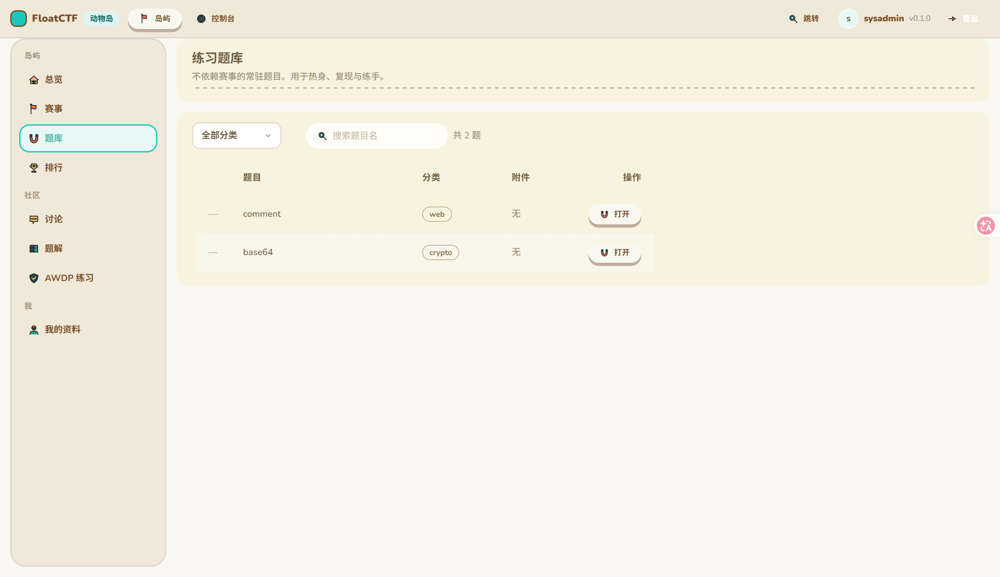
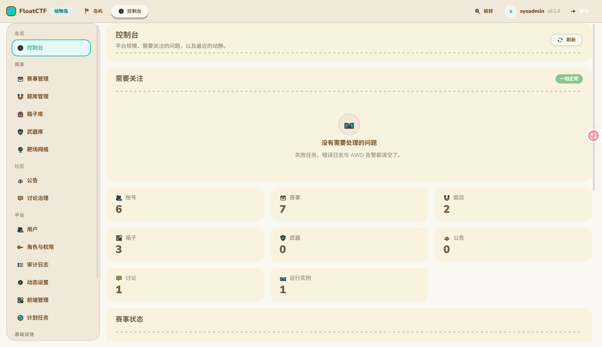
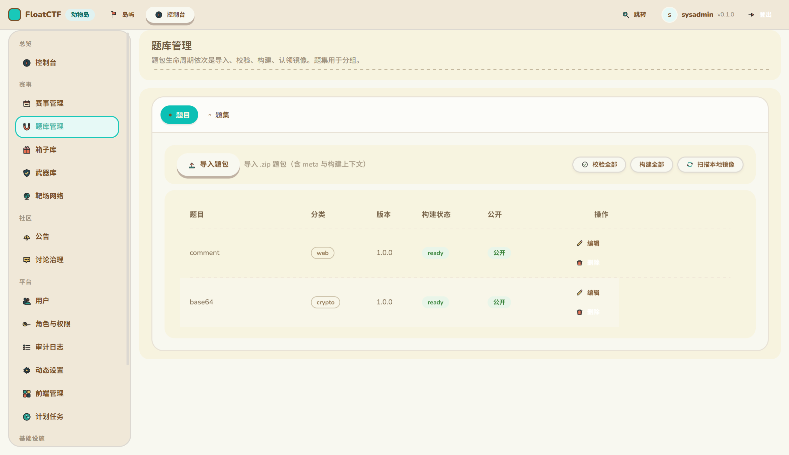
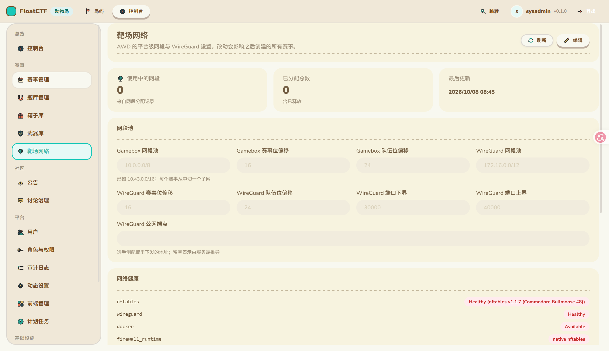
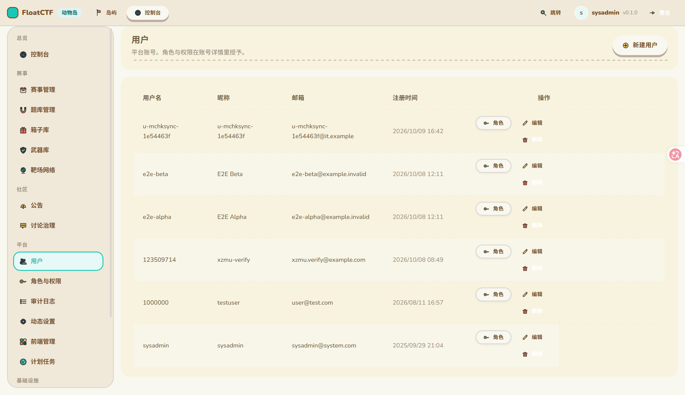
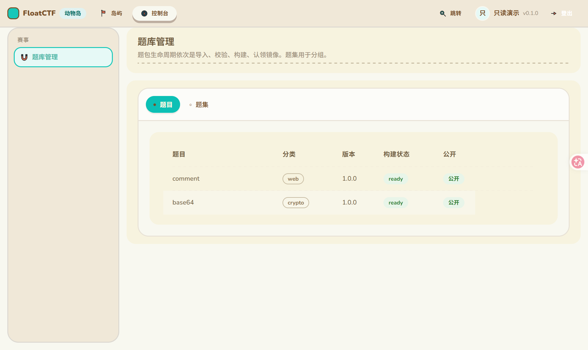

# FloatCTF · Animal Island

一个 **FloatCTF 可插拔前端**（选手端 + 管理端），视觉与组件建立在
[`animal-island-ui`](https://github.com/guokaigdg/animal-island-ui) v2.2.1（MIT，39 个组件）之上。

- Frontend id：`animal-island`
- 包名：`@floatctf/frontend-animal-island`
- API 契约：**major 2**（`compatibility.apiContract` 必须是 `"2"`）
- 技术栈：React 19 · TypeScript · Vite 6 · react-router v7 · TanStack Query v5 · zustand v5

## 截图

均为在真实 FloatCTF 实例上运行、**真实接口数据**的实拍（非设计稿、非 mock）。

| 登录 | 岛屿总览（选手端） |
|---|---|
|  |  |

| 赛事列表 | 题库 |
|---|---|
|  |  |

| 控制台总览（管理端） | 题库管理 |
|---|---|
|  |  |

| 箱子库 | 用户管理 |
|---|---|
|  |  |

### 权限只读视角（重点）

下面这张是**同一个「题库管理」页面**，用只有 `challenges.read` 的账号登录：



对比上面的管理端截图，可以看到：

- 侧栏只剩 **1 个**菜单项（有权限的那些才出现，空分组不残留）；
- 「导入题包 / 校验全部 / 构建全部 / 扫描本地镜像」**全部消失**；
- 表格行内的「编辑 / 删除」**全部消失**，整个「操作」列也不渲染（不留空列）；
- 但**数据照常可见** —— 只读用户该看到的事实一条不少。

完整截图集（21 张，含 AWD / AWDP / 讨论 / 题解 / 排行 / 审计日志 / Docker / SQL / 终端 / 计划任务等）
见 [`docs/screenshots/`](./docs/screenshots/)。

## 当前状态

**覆盖口径：`complete（选手端 + 管理端）`。**

- **37 个页面，0 个骨架页**；42 条路由。
- 覆盖 `CAPABILITY-MATRIX.md` 的**全部 93 条 `required`**（逐条机械核对，方法见
  [CAPABILITY-COVERAGE.md](./CAPABILITY-COVERAGE.md)）。
- 三大赛制齐备：Jeopardy（解题 / 排行 / 题解 / 讨论）、**AWD**（选手 + 管理）、
  **AWDP**（选手 + 练习 + 管理）。

### 验证状态（如实区分）

| 项目 | 状态 |
|---|---|
| `tsc --noEmit` | ✅ 0 错误 |
| `vite build` | ✅ 通过（637 模块） |
| 制品 / 源码 manifest | ✅ 均通过**平台自己的校验器** |
| 权限与导航测试 | ✅ **26 项断言**（`pnpm test`，含 32 个写按钮的逐个门控检查） |
| **独立仓库 install + build** | ✅ 在 monorepo 之外用 packed tarball 实测通过 |
| **运行时端到端** | ✅ 已在真实实例上跑通：登录 → `/me` → 各页面真实数据 → 权限分级实测 |

运行时验收的具体内容：`POST /api/session` 登录、`/me` 返回 29 条权限与 `grants_all`、
34 个接口的真实数据渲染、以及**受限账号的授权强制**（未授权写操作被后端 403 拒绝，
与前端隐藏的入口一一对应）。

## 两级权限显隐

权限在本前端有**两个**落点，缺一不可：

| 级别 | 机制 | 效果 |
|---|---|---|
| **菜单级** | `src/app/nav.ts` 的 `permission` 声明 + `visibleConsoleNav()` | 没权限 → **侧栏里根本没有这个入口**（空分组也会被剔除） |
| **动作级** | `src/app/permissions.tsx` 的 `useCan()` / `<Can permission="…">` | 只有读权限 → 进得去页面，但**看不到写按钮** |

只做菜单级时，一个只有 `weapons.read` 的人能进武器库，然后看到「新增 / 编辑 / 删除 / 上传」——
点了才吃 403。那是把权限变成**事后惩罚**而不是事前引导。

**为什么隐藏而不是禁用**：对一个真的点不动的按钮，隐藏比灰掉更诚实（灰按钮会让人反复尝试、
怀疑是网络问题）。唯一例外是「状态即开关」的列（如箱子库的「可见 / 已隐藏」）——
只读用户仍应看到状态，只是点不动。

**唯一真相源**：动作对应的权限**不是编的**，逐条取自平台路由表。例如赛事公告的写操作是
`events.manage`（**不是** `announcements.manage`，那个是平台级公告的权限）；角色授予是
`roles.manage`（不是 `users.manage`）。

### 这不是授权

两级显隐都只决定**界面上显不显示**。真正的判定永远在服务端每个请求上。因此**所有写动作都保留
错误处理**，不因为 `useCan()` 返回 true 就假设一定成功。

`hasPermission()` 的短路顺序是最容易写错的一处：持有全权角色时后端返回的 `permissions`
**通常是空数组**（权限来自短路），因此必须**先看 `grants_all`**；反过来全权管理员会被判成
「什么权限都没有」，然后看到一个空控制台 —— 而「看不到东西」通常不会有人报 bug。

## 安装与运行

### 依赖来源（**先读这一节**）

本前端依赖三个平台包：`@floatctf/sdk`、`@floatctf/frontend-runtime`、`@floatctf/react`。

> ⚠️ **它们目前尚未发布到 npm。** 因此直接 `pnpm install` 会 404。

在 FloatCTF monorepo 里它们通过 `workspace:*` 引用；而 `workspace:*` 是**仓库内协议**，
独立仓库不能用。正确做法是先打包再引用：

```bash
# ① 在 FloatCTF monorepo 里构建并打包
pnpm run build:packages
pnpm --filter @floatctf/frontend-runtime --filter @floatctf/sdk --filter @floatctf/react \
   pack --pack-destination /tmp/pkgs

# ② 在本仓库里指向这些 tarball 并安装
./scripts/use-local-packages.sh /tmp/pkgs
pnpm install
```

`scripts/use-local-packages.sh` 会把 `pnpm-workspace.yaml` 的 `overrides` 写成指向
本地 tarball。**为什么必须用 overrides 而不是只改直接依赖**：`@floatctf/react` 自身
依赖 `@floatctf/sdk@1.0.0`，只改直接依赖的话，这条**传递依赖**仍会去 registry 找而 404。

### 两个 pnpm 11 的坑（会让配置看起来"写了但没生效"）

1. **`pnpm` 字段不再被读取**。pnpm 11 起，原来放在 `package.json` 里的 `pnpm.overrides`
   **被静默忽略**（只打印一行 WARN），必须写在 `pnpm-workspace.yaml`。
2. **构建脚本默认被拦截**，且旧名 `onlyBuiltDependencies` 不再生效。正确写法是
   `pnpm-workspace.yaml` 里的 `allowBuilds` **map + 显式布尔**：

   ```yaml
   allowBuilds:
     esbuild: true
   ```

   否则 `pnpm install` 会以 `ERR_PNPM_IGNORED_BUILDS` 失败（依赖其实装上了，但 esbuild
   的 postinstall 被拦，`vite build` 起不来）。

### 命令

```bash
pnpm dev          # 开发服务器 :13500，自带 /api 代理到 :7780（同源，无需改后端 CORS）
pnpm build        # vite build && tsc --noEmit
pnpm typecheck    # tsc --noEmit
pnpm test         # 26 项断言：导航/权限/逐个写按钮门控（必须在仓库根目录运行）
```

在 FloatCTF monorepo 内作为 workspace 成员时：

```bash
mise exec -- pnpm --filter @floatctf/frontend-animal-island typecheck
mise exec -- pnpm --filter @floatctf/frontend-animal-island build
```

## 制品

构建产物 `dist/`：

| 文件 | 说明 |
|---|---|
| `assets/frontend.js` | 入口，导出 `mount(context)` |
| `assets/frontend.css` | 全站唯一样式（含库样式与字体，**完全自包含**） |
| `frontend.json` | 运行时 manifest；由 Vite 插件生成并用 `parseFrontendManifest` **自检** |

**已知取舍**：`assets/frontend.css` 约 4.88MB（gzip 3.60MB）。库的 CSS 用相对
`url("files/...")` 引用 9 个 woff2（其中 Noto Sans SC 的 CJK 子集约 3.8MB），Vite 会把这些
字体 **base64 内联**进 CSS —— 实测 `build.assetsInlineLimit: 0` 对 CSS 内的字体引用**不生效**。
收益是产物零外部依赖（不会字体 404）；要瘦身可删掉 CSS 里 `noto-sans-sc` 的 `@font-face`
块，字体栈已有 `PingFang SC / Microsoft YaHei` 兜底。

## 设计底线

见 [AGENTS.md](./AGENTS.md) 末尾的《animal-island-ui 设计法》。最容易踩的几条：
**Card 没有 box-shadow**、**图标只能用 `naive-icons`**（禁 emoji / Unicode 符号 / 手写 SVG）、
**焦点环输入类用黄 `#ffcc00` 其余用青 `#19c8b9`**（禁冷蓝）、**UI 文本不用等宽字体**、
**不要用 className/style 覆盖库组件的颜色/圆角/阴影**。

## 认证

- 唯一登录入口 `POST /api/session`；令牌存 `localStorage`（由本前端自己拥有）。
- **401 与 403 严格分流**：401 清会话并引导重新登录；**403 只提示，绝不清会话**
  （重新登录解决不了权限问题）。见 `src/api/client.ts`。
- 前端守卫只判断「有没有会话」与「入口显不显示」；**权限判定永远在服务端**。

## 制品发布（CI / GitHub Release）

`.github/workflows/release.yml` 在 `main`、`v*` tag 与手动 dispatch 时构建 3 个资产，
消费方（平台宿主）**只下载、不构建**：不执行本仓库代码，也不需要 Node。

| 资产 | 说明 |
|---|---|
| `frontend-dist.tar.gz` | `tar -C dist .` 打包，`frontend.json` 在归档根部（`frontend.sh` 的 `normalize_artifact_root` 无需猜层级） |
| `frontend-dist.tar.gz.sha256` | 校验和 |
| `BUILD_INFO.json` | 构建元数据（repository/commit/ref/workflow_run/node/files/bytes/built_at）。其中 **`frontend` 字段是 `dist/frontend.json`（制品 manifest）的原样副本**，供前端市场与人工核对读取 `id`/`version`/`compatibility`，**无需下载整个 tar.gz** |

稳定下载地址（滚动通道，public 仓库无需凭据）：

```bash
gh release download frontend-latest -R FloatCTF/floatctf-frontend-animal-island -p 'frontend-dist.tar.gz*'
sha256sum -c frontend-dist.tar.gz.sha256
frontend.sh install frontend-dist.tar.gz
```

`v*` tag 会额外产出永久保留的版本 release（资产名相同）。

`@floatctf/*` 未发布到 npm，CI 因此：克隆平台 monorepo → `pnpm install --frozen-lockfile` →
`scripts/package-sdk-dist.sh`（构建并打包三个包，确定性命名 + fail-closed 校验）→
`./scripts/use-local-packages.sh <dir>`（把 `pnpm-workspace.yaml` 的 `overrides` 指向本地 tarball，
覆盖传递依赖）→ `pnpm install --no-lockfile` → `pnpm build` →
硬检查 `dist/frontend.json`（存在、**不含 `build` 段**、字段齐全、声明的 entry/styles 在）→ 打包。

> 契约对齐：制品的 `compatibility.frontendRuntime` / `apiContract` 必须与平台 monorepo 的
> `packages/frontend-runtime/src/version.ts` 一致，否则消费侧 `frontend.sh` 会拒绝安装。
> 可用仓库变量 `FLOATCTF_MONOREPO_REF`（默认 `main`）指定平台 ref；不一致时 CI 在构建前显式失败，
> 而不是产出装不上的制品。

## 许可

AGPL-3.0-only，见 [LICENSE](./LICENSE)。
